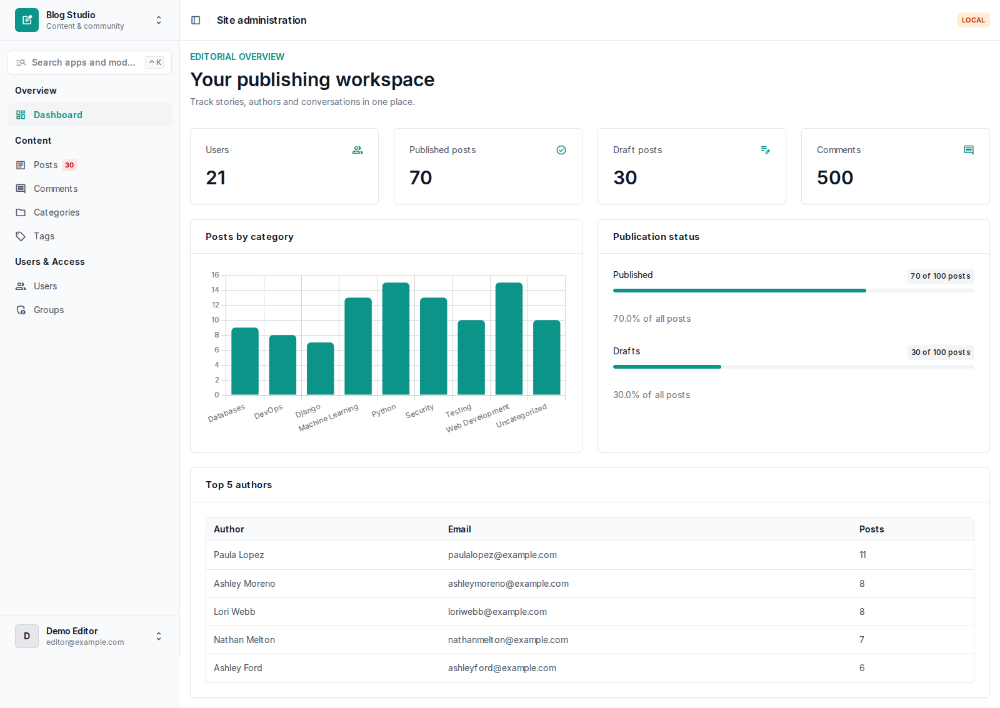
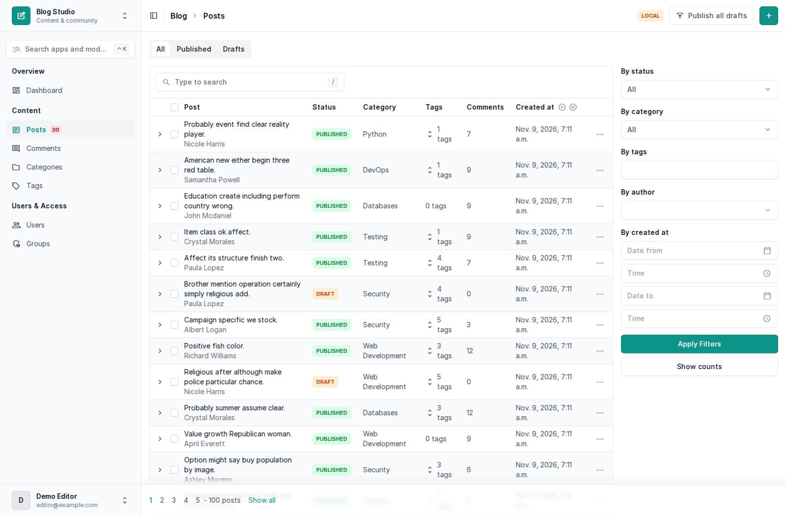
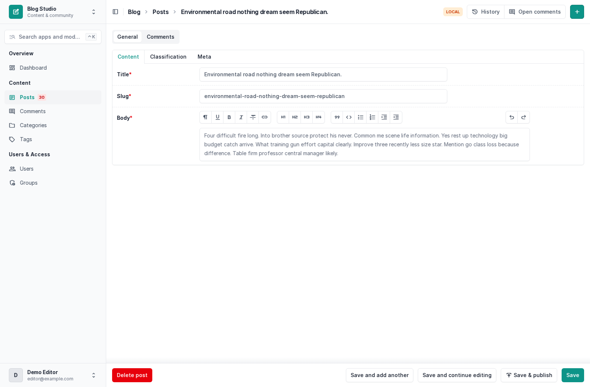
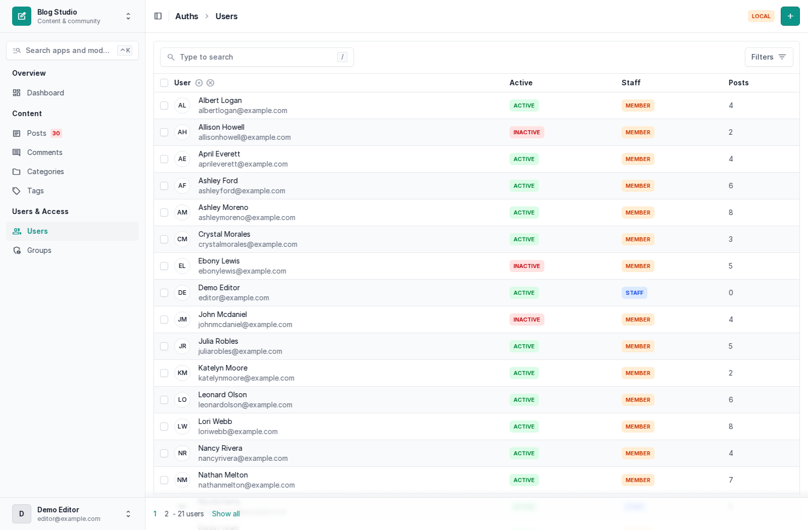
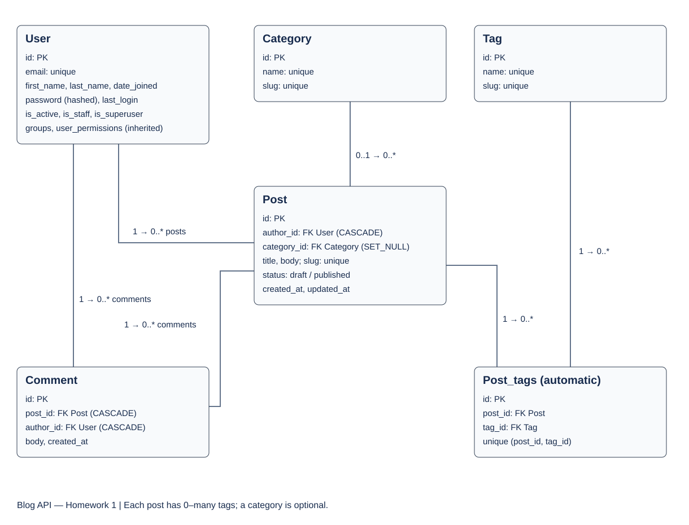

# Blog API — Homework 2

Editable Django project for Practice Works #1 and #2. Python 3.12+ recommended.

## Scope

Homework 1 foundation plus the complete Homework 2 implementation: atomic bulk seed,
Django Unfold admin, filters, tabs, expandable rows, publication actions and dashboard.
No GitHub repository has been published and no Oqulabs submission has been made.

## Quick start (Windows)

Install Python 3.12+ and double-click `start.bat` inside the extracted hw2 folder.
It creates a virtual environment, installs dependencies, generates settings/.env with a
random secret (without overwriting an existing file), migrates the database, and seeds
it on the first run. Choose Y to create an administrator, then open
http://127.0.0.1:8000/admin/. On later runs choose N if an administrator already exists.
The server stays in the terminal; stop it with Ctrl+C.

Manual alternative, in CMD from the folder containing manage.py:

```bat
py -m venv .venv
.venv\Scripts\activate
python -m pip install -r requirements/dev.txt
python setup_local.py
python manage.py migrate
python manage.py seed
python manage.py createsuperuser
python manage.py runserver
```

`BLOG_REPOSITORY_URL` in settings/.env controls the GitHub menu link; set it to your
actual repository URL. Its default is the intended Serzhan17/blog-api target, not a
claim that this repository has been created.

## Seeding

```bash
python manage.py seed
python manage.py seed --users 50 --posts 300 --comments 1500
python manage.py seed --clear
python manage.py seed --help
```

| Argument | Default | Meaning |
| --- | ---: | --- |
| --users | 20 | New users |
| --posts | 100 | New posts |
| --comments | 500 | New comments |
| --clear | off | Delete content and non-superusers before seeding |

Seeded users share the LOCAL DEMO password `BlogDemo-2026!`. Email addresses are shown
in the Users list; some users are deliberately inactive. Use createsuperuser for your
own administrator. Seed staff have no automatically granted content permissions.
Never use the shared seed password for production accounts.

Repeated runs append users/posts/comments with unique emails and slugs. Categories and
tags are reused. About 70% of newly created posts are published, 10% have no category,
and comments target only published posts. Counts are rounded for small requests.
The command is atomic: invalid counts or missing relationships roll back all changes,
including --clear. Existing users/published posts can satisfy zero-create requests.

## Admin

Teal primary palette, Local/Production badge, model search (Ctrl+K), custom sidebar,
draft badge, and All/Published/Drafts tabs are configured in settings/unfold.py.
Users & Access is only visible to superusers. Normal Django permissions still control
model access; hiding navigation alone does not grant or revoke permissions.
Dashboard totals require view permissions for users, posts, comments and categories.

- Categories/tags: prepopulated slugs, name search, sortable database post counts.
- Categories: expandable posts table.
- Comments: autocomplete filters, date range, text search, shortened body.
- Users: name/email/initials, status labels, radio filters, tabs and custom email forms.
- Activate/deactivate bulk actions; deactivation preserves the acting administrator.
- Posts: status labels, tag dropdown, comment counts, related filters and expandable comments.
- Bulk publish/draft, row publish/unpublish, publish-all-drafts, open-comments detail action.
- Save & publish runs after the form is saved. All writes use POST with CSRF protection;
  row/list actions show a confirmation page first.
- Rich text editor, autocomplete, read-only dates, unsaved-change warning.
- Comments inline in a separate tab, paginated at 10 entries.
- Dashboard: cards, category bar chart, top authors table, publication progress.

Screenshots below were captured from the running project with synthetic demo data.
Your randomized seed data will differ.






## HW2 verification

```bash
python manage.py check
python manage.py test
python manage.py makemigrations --check --dry-run
ruff check .
ruff format --check .
```

20 tests cover HW1 plus repeated seed, hash verification, relationship constraints,
clear/superuser preservation, invalid inputs/atomic rollback, slug collisions, every
admin page, empty dashboard, publication permissions, CSRF, Save & publish, inline
pagination and constant query counts for 10 versus 100 rows.
Enable BLOG_SQL_DEBUG=True temporarily to inspect SQL queries manually.

## Submit HW2 using your existing repository

If HW1 is already committed and merged into main, run these commands in THAT repository
before copying the new files from this archive into it:

```bash
git switch main
git switch -c hw2
```

Copy the contents of this hw2 folder alongside manage.py, overwriting the old code.
Keep your existing .git folder and settings/.env. Do not put a nested hw2 folder inside
the repository. Reinstall requirements and run the verification commands above, then:

```bash
git add .
git commit -m "Implement Homework 2 seed and Unfold admin"
git switch main
git merge --no-ff hw2 -m "Merge Homework 2"
git push origin main hw2
```

Keep both hw1 and hw2 branches. If you have not set up Git yet, first commit the ORIGINAL
hw1 archive on branch hw1 and merge it into main using the HW1 instructions below.
Then create hw2 and copy this code. The archive deliberately contains no .git folder,
secret .env, database, virtual environment or log files.

## Entity relationship diagram



The diagram was created before the model implementation. Django automatically creates
Post_tags for the many-to-many relationship. PermissionsMixin also provides Django's
standard groups, permissions and is_superuser fields. date_joined is an extra user field
for the admin dates section.

## Windows: start from CMD

Extract the archive, open the hw2 folder in VS Code, and select a Command Prompt terminal.
Run from the folder containing manage.py:

```bat
py -3.12 -m venv .venv
.venv\Scripts\activate
python -m pip install -r requirements/dev.txt
copy settings\.env.example settings\.env
python -c "from django.core.management.utils import get_random_secret_key; print(get_random_secret_key())"
```

Paste the generated value into BLOG_SECRET_KEY in settings/.env, enclosed in double
quotes. Keep BLOG_ENV_ID=local. If Python 3.12 is not installed, use `py -m venv .venv`
with an installed supported Python version.

```bat
python manage.py migrate
python manage.py createsuperuser
python manage.py runserver
```

Open http://127.0.0.1:8000/admin/ and log in with your email and password.
Password characters are not displayed while createsuperuser asks for the password.
The root URL `/` has no page; use `/admin/`.
Create a category and tags first, then a post and a comment.

## Linux / macOS

```bash
python3 -m venv .venv
source .venv/bin/activate
python -m pip install -r requirements/dev.txt
cp settings/.env.example settings/.env
# Set BLOG_SECRET_KEY to a generated random value before continuing.
python manage.py migrate
python manage.py createsuperuser
python manage.py runserver
```

## Editing map

| File | Purpose |
| --- | --- |
| apps/auths/models.py | User and email-based manager |
| apps/auths/forms.py | Admin user creation and editing |
| apps/auths/admin.py | User admin layout |
| apps/auths/urls.py | JWT routes |
| apps/blog/models.py | Category, Tag, Post and Comment |
| apps/blog/admin.py | Basic admin for blog models |
| settings/conf.py | BLOG_ environment variables |
| settings/base.py | Shared configuration |
| settings/env/local.py | SQLite and DEBUG=True |
| settings/env/prod.py | PostgreSQL and DEBUG=False |

After changing model fields:

```bash
python manage.py makemigrations
python manage.py migrate
```

Slug fields are unique and are entered explicitly in code. The admin prepopulates them
from names/titles; change a duplicate slug manually. User creation through the manager
requires first_name and last_name and lowercases the entire email address.

## JWT authentication

POST `/api/auth/token/` with JSON:

```json
{"email": "your-email@example.com", "password": "your-password"}
```

The response contains `access` and `refresh`. POST `/api/auth/token/refresh/` with
`{"refresh": "YOUR_REFRESH_TOKEN"}` for a new access token. Use
`Authorization: Bearer YOUR_ACCESS_TOKEN` for future protected API endpoints.
Create users through the admin or manager; public registration is not included.

## Verification

```bash
python manage.py check
python manage.py test
python manage.py makemigrations --check --dry-run
ruff check .
ruff format --check .
```

Tests cover password hashing, email normalization, required manager fields,
superuser flags, admin user creation, JWT login/refresh, inactive-user rejection,
admin pages, unique slugs and relationship deletion rules.

## Production configuration

Install `requirements/prod.txt`, set BLOG_ENV_ID=prod and configure all database
variables and BLOG_ALLOWED_HOSTS in settings/.env or the process environment.
Use a strong secret, an HTTPS reverse proxy, PostgreSQL and a production WSGI/ASGI
server configured by your hosting provider. Run migrations and collectstatic there.
Production is configured but has not been connected to a real PostgreSQL server here.

All project-specific environment variables use the BLOG_ prefix. manage.py reads the
environment selector through settings/bootstrap.py; WSGI and ASGI use the same helper.
Local settings then import base.py, which imports conf.py and reads settings/.env.
The .env, databases, logs and virtual environments are excluded from Git and this archive.
The logs directory is created automatically on startup.

## Initial Git setup (use the original HW1 code for this step)

On GitHub, create a PUBLIC repository called `blog-api` without initial files.
Inside the original extracted hw1 folder run (replace YOUR_USERNAME):

```bash
git init -b main
git commit --allow-empty -m "Initialize repository"
git switch -c hw1
git add .
git commit -m "Implement Homework 1 blog models and configuration"
git switch main
git merge --no-ff hw1 -m "Merge Homework 1"
git remote add origin https://github.com/YOUR_USERNAME/blog-api.git
git push -u origin main
git push -u origin hw1
```

Keep branch hw1. For the second assignment create hw2 from main.
Folder name hw1 and Git branch hw1 are different things.
Follow the instructor's Oqulabs submission instructions once available.

## References

- https://docs.djangoproject.com/en/5.2/topics/auth/customizing/
- https://www.django-rest-framework.org/api-guide/authentication/
- https://django-rest-framework-simplejwt.readthedocs.io/en/stable/
